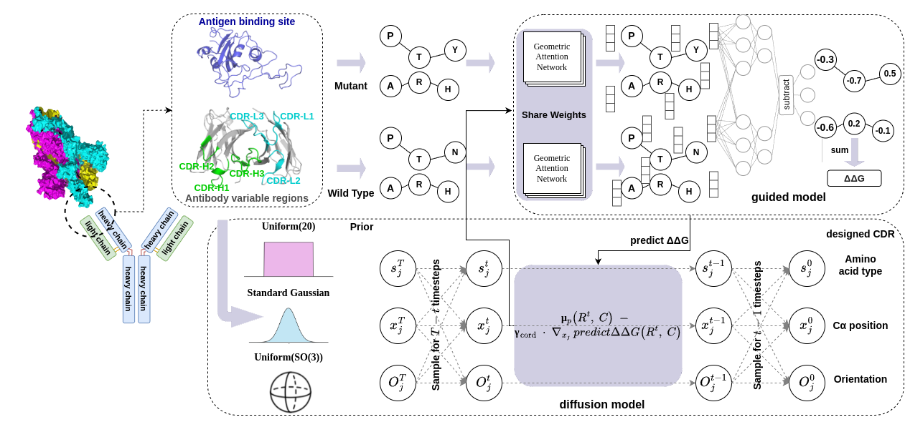

# AffiGuide



**AffiGuide** is a differentiable affinity-guided antibody diffusion framework for CDR sequence-structure co-design. It integrates learning-based binding-property predictors into the reverse diffusion sampling process to steer generated CDR sequences and conformations toward improved predicted antibody-antigen binding properties.

This implementation is built on the DiffAb backbone and extends it with ΔΔG-guided coordinate and sequence guidance, hydropathy-aware sequence priors, and optional GearBind-based affinity guidance.

The project supports:

- unguided DiffAb-style CDR co-design;
- hydropathy-aware sampling using a developability prior;
- ΔΔG-guided sampling with the Helixon binding-ddG predictor;
- optional GearBind-based ΔΔG guidance through a DiffAb-to-GearBind bridge;
- single-CDR and multi-CDR redesign;

This repository is intended for computational method development and in silico screening. Generated designs should be experimentally validated before practical use.

## Background

This codebase builds on:

- [DiffAb](https://github.com/luost26/diffab), a diffusion model for antigen-specific antibody design and optimization.
- [Antibody-Diffusion-Properties](https://github.com/amelvim/antibody-diffusion-properties), which introduced property-guided variants of DiffAb, including hydropathy-based guidance.
- [Helixon binding-ddG predictor](https://github.com/HeliXonProtein/binding-ddg-predictor), used here as a differentiable ΔΔG predictor.
- [GearBind](https://github.com/DeepGraphLearning/GearBind), optionally used as an additional protein-protein binding affinity change predictor.

## Installation

### 1. Default environment

The default environment supports DiffAb sampling, the Helixon ddG predictor guidance path, and hydropathy-aware sampling.

```bash
conda env create -f envs/affiguide-ddgpred.yml
conda activate affiguide
```

### 2. Optional GearBind environment

GearBind-guided sampling requires additional graph-learning dependencies. Use the optional environment below if you plan to run `--ddg_guidance_model gearbind`.

```bash
conda env create -f envs/affiguide-gearbind.yml
conda activate affiguide-gearbind
```

CUDA versions may need to be adjusted for your GPU and cluster environment.

## Data and model weights

Large model checkpoints are not included in this repository. Please download the required checkpoints separately and place them under the paths below.

### DiffAb checkpoint

Download the DiffAb pretrained checkpoint from the original DiffAb release and set the checkpoint path in the corresponding YAML config, for example under:

```text
trained_models/
```

### SAbDab structures

For training or full benchmark evaluation, download SAbDab structures and place them in the `data` directory following the original DiffAb layout.

### ddG predictor checkpoint

The Helixon ddG predictor checkpoint should be placed at:

```text
diffab/tools/ddg/data/model.pt
```

This checkpoint is loaded by `diffab/tools/ddg/predictor.py`.

### GearBind checkpoints

If using GearBind guidance, place the GearBind model checkpoint under:

```text
diffab/tools/GearBind/checkpoints/
```

By default, AffiGuide uses the GearBind prediction config in:

```text
diffab/tools/GearBind/config/predict/CR3022_GearBindP.yaml
```

The checkpoint path and default chain grouping are handled by the GearBind wrapper and the corresponding config file.


## Configuration files

Guided redesign is controlled by a small set of sampling options in the YAML config and command-line arguments.

Recommended configs:

| Config file | Description |
|---|---|
| `configs/test/codesign_single_guided.yml` | single-CDR sequence-structure redesign |
| `configs/test/codesign_multicdrs_guided.yml` | simultaneous multi-CDR sequence-structure redesign |

Key guidance options:

| Option | Meaning |
|---|---|
| `sample_ddg` | enable ΔΔG guidance |
| `sample_hydro` | enable hydropathy-aware prior |
| `hydro_prior_b` | hydropathy prior strength |
| `ddg_guidance_model` | `ddgpred`, `gearbind`, or `gearb` |
| `ddg_ref` | `scaled` or `prev` for ddG predictor guidance |
| `gradient_scale_cord` | coordinate guidance scale |
| `gradient_scale_categ` | sequence guidance scale |
| `task` | `redesign` or `external` |

For GearBind guidance, `ddg_ref` is set internally to the native complex reference.

## Antibody design

### Single-CDR redesign

Run unguided DiffAb-style sampling:

```bash
python design_pdb.py ./data/examples/7DK2_AB_C.pdb \
  --config ./configs/test/codesign_single_guided.yml \
  --no_sample_ddg \
  --no_sample_hydro
```

Run ΔΔG-guided sampling with the ddG predictor:

```bash
python design_pdb.py ./data/examples/7DK2_AB_C.pdb \
  --config ./configs/test/codesign_single_guided.yml \
  --sample_ddg \
  --no_sample_hydro \
  --ddg_guidance_model ddgpred \
  --ddg_ref scaled \
  --gradient_scale_cord 4.0 \
  --gradient_scale_categ 1.0
```

Run ΔΔG + hydropathy-guided sampling:

```bash
python design_pdb.py ./data/examples/7DK2_AB_C.pdb \
  --config ./configs/test/codesign_single_guided.yml \
  --sample_ddg \
  --sample_hydro \
  --hydro_prior_b 0.8 \
  --ddg_guidance_model ddgpred \
  --ddg_ref scaled \
  --gradient_scale_cord 4.0 \
  --gradient_scale_categ 1.0
```

### GearBind-guided sampling

```bash
python design_pdb.py ./data/examples/7DK2_AB_C.pdb \
  --config ./configs/test/codesign_single_guided.yml \
  --sample_ddg \
  --no_sample_hydro \
  --ddg_guidance_model gearbind \
  --gradient_scale_cord 4.0 \
  --gradient_scale_categ 1.0
```

Do not pass `--ddg_ref native` from the command line. The GearBind branch uses the native reference internally.

### Multi-CDR redesign

```bash
python design_pdb.py ./data/examples/7DK2_AB_C.pdb \
  --config ./configs/test/codesign_multicdrs_guided.yml \
  --sample_ddg \
  --sample_hydro \
  --ddg_guidance_model ddgpred \
  --ddg_ref scaled \
  --gradient_scale_cord 4.0 \
  --gradient_scale_categ 1.0
```

The list of CDRs to redesign is controlled by the `sampling.cdrs` field in the YAML config.

### Test-set redesign

```bash
for i in {0..18}; do
  python design_testset.py $i \
    --config ./configs/test/codesign_single_guided.yml \
    --sample_ddg \
    --sample_hydro \
    --ddg_guidance_model ddgpred \
    --ddg_ref scaled \
    --gradient_scale_cord 4.0 \
    --gradient_scale_categ 1.0
done
```


## Files not included

Large model checkpoints are not included in this repository. Please download the required checkpoints separately and place them under the paths described above.

Generated output directories, such as `results/`, are created when running sampling or analysis scripts and are not required in the source repository.

## Notes on external code

This repository contains code adapted from DiffAb and from property-guided DiffAb variants. It also integrates the Helixon binding-ddG predictor and optionally GearBind. Please keep the original license notices and cite the corresponding works when using this code.

Third-party components retain their original license terms and copyright notices.

## References

If you use this code, please cite the relevant upstream methods.

```bibtex
@inproceedings{luo2022antigenspecific,
  title={Antigen-Specific Antibody Design and Optimization with Diffusion-Based Generative Models for Protein Structures},
  author={Shitong Luo and Yufeng Su and Xingang Peng and Sheng Wang and Jian Peng and Jianzhu Ma},
  booktitle={Advances in Neural Information Processing Systems},
  year={2022},
  url={https://openreview.net/forum?id=jSorGn2Tjg}
}
```

```bibtex
@article{villegas2024guiding,
  title={Guiding diffusion models for antibody sequence and structure co-design with developability properties},
  author={Amelia Villegas-Morcillo and Jana M. Weber and Marcel J. T. Reinders},
  journal={PRX Life},
  volume={2},
  number={3},
  pages={033012},
  year={2024}
}
```

```bibtex
@article{shan2022deep,
  title={Deep learning guided optimization of human antibody against SARS-CoV-2 variants with broad neutralization},
  author={Shan, Sisi and Luo, Shitong and Yang, Ziqing and Hong, Junxian and Su, Yufeng and Ding, Fan and Fu, Lili and Li, Chenyu and Chen, Peng and Ma, Jianzhu and others},
  journal={Proceedings of the National Academy of Sciences},
  volume={119},
  number={11},
  pages={e2122954119},
  year={2022}
}
```

```bibtex
@article{cai2024gearbind,
  title={Pretrainable geometric graph neural network for antibody affinity maturation},
  author={Cai, Huiyu and Zhang, Zuobai and Wang, Mingkai and Zhong, Bozitao and Li, Quanxiao and Zhong, Yuxuan and Wu, Yanling and Ying, Tianlei and Tang, Jian},
  journal={Nature Communications},
  volume={15},
  pages={7785},
  year={2024},
  doi={10.1038/s41467-024-51563-8}
}
```

## License

This project is released under the Apache License 2.0. See `LICENSE` for details.

This repository includes code adapted from DiffAb, Antibody-Diffusion-Properties, the Helixon binding-ddG predictor, and GearBind. Third-party components retain their original license terms and copyright notices. See `NOTICE` for attribution.
